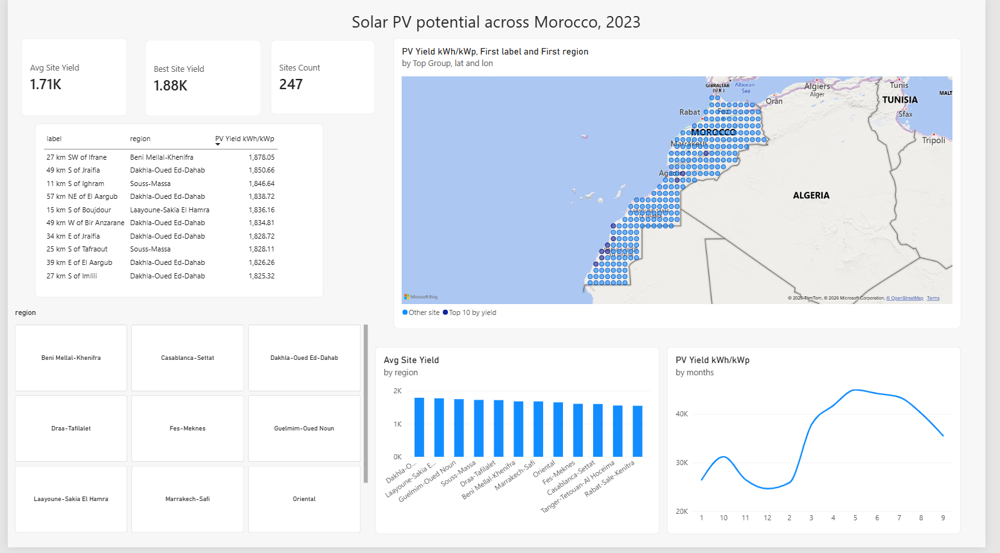
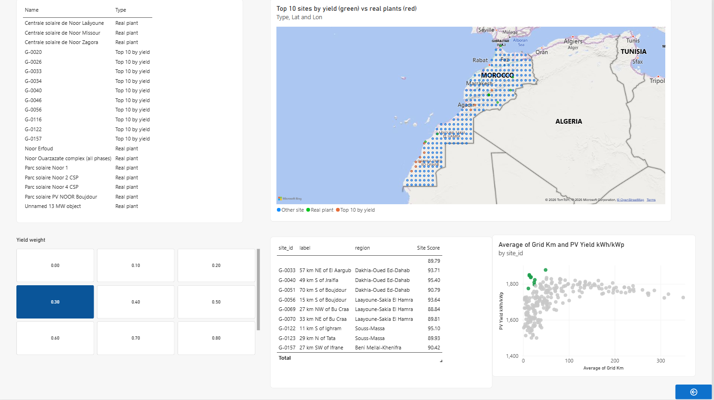
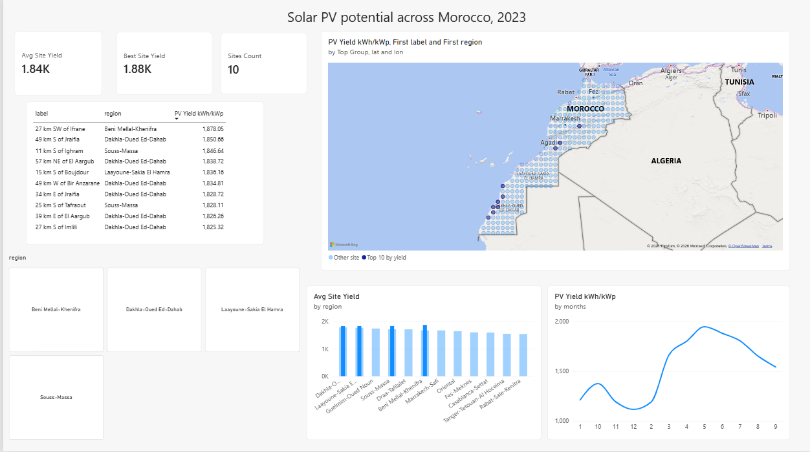
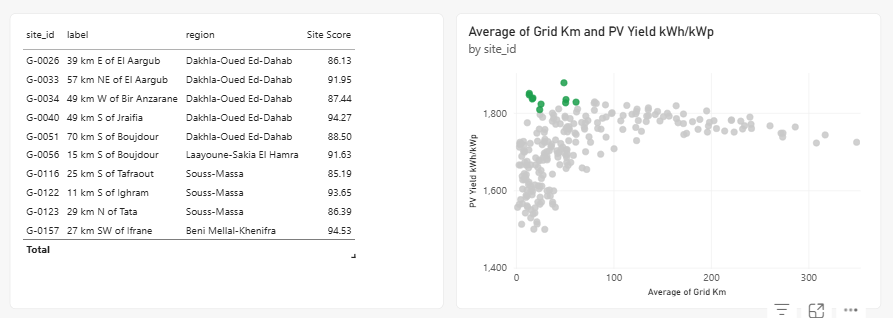
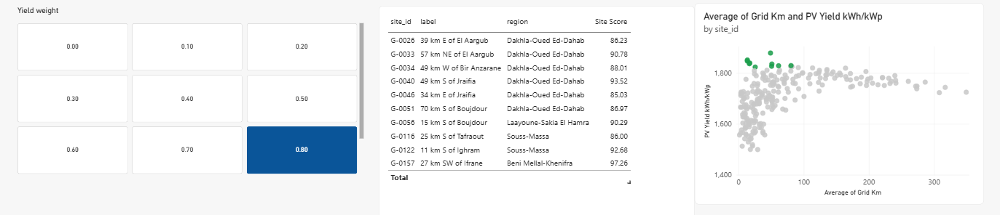
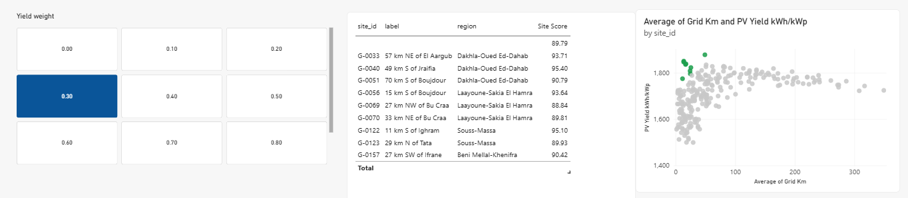
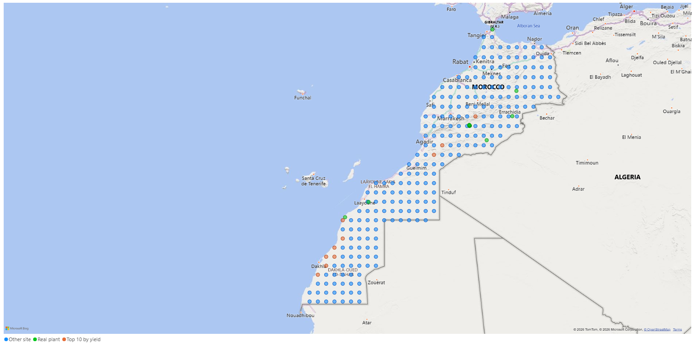
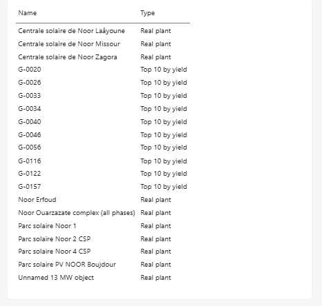

# Solar PV Site Screening, Morocco

A screening model that ranks 247 locations across Morocco for solar PV by combining
**energy yield** (what a panel would produce) and **grid access** (distance to the
nearest substation). Stack: Python, PostgreSQL, Power BI.

MODEL

MODEL VS REALITY

## Results at a glance

| Hypothesis | Result |
|---|---|
| **H1.** The highest yield is in the far south | **Confirmed.** 6 of the top 10 sites are in Dakhla-Oued Ed-Dahab. |
| **H2.** Adding grid distance changes the ranking | **Partly.** Rank correlation 0.76; 8 of the top 10 stay the same. |
| **H3.** The ranking is robust to the weights | **Confirmed in the range tested.** 9 sites are in the top 10 in at least 5 of 7 weight settings. |
| **H4.** The model matches where real plants were built | **Partly.** It agrees in the far south and disagrees in the interior. |

Annual yield: 1,499 to 1,878 kWh/kWp across sites (mean about 1,711).

## 1. Data sources

| Data | Source | Period / size | Used for |
|---|---|---|---|
| Hourly weather: shortwave radiation, temperature at 2 m, wind at 100 m, direct normal irradiance | ERA5 reanalysis [via ... , access date] | 2023, 247 sites x 8,760 h = 2,163,720 rows | Yield model |
| Substations | OpenStreetMap [Overpass, access date] | 622 objects, 270 with a voltage tag | Grid distance |
| Solar plants | OpenStreetMap [access date] | 490 objects; 10 have a capacity of 1 MW or more | H4 (reality check) |
| Site grid | Generated: regular 0.5 degree lattice over Morocco | 247 points (G-0067 excluded: region unreliable) | Candidate sites |

Direct normal irradiance is loaded but not used in the yield; it is kept to test the
CSP explanation for H4. Only 11 of 490 OSM solar objects carry a capacity tag, so the
plant sample is small.

## 2. Pipeline and data model

**How the data flows.**
Raw hourly weather files, one per site (bronze) → yearly yield per site computed in Python (silver) → PostgreSQL → Power BI.
The raw files are kept, so if I change an assumption I can recompute the yields without downloading again.

**PostgreSQL tables**

| Table | Rows | Content |
|---|---|---|
| `dim_site` | 247 | One row per site: `site_id`, `lat`, `lon`, `label` (e.g. "27 km SW of Ifrane"), `region`, `substation_km`, `hv_substation_km` |
| `fact_hourly` | 2,163,720 | One row per site and hour: `site_id`, `ts`, `shortwave_radiation`, `temperature_2m`, `wind_speed_100m` |
| `dim_substation` | 622 | Substations from OpenStreetMap, with `voltage_kv` |
| `dim_solar_plant` | 10 | Real plants of 1 MW or more: `name`, `capacity_mw`, `lat`, `lon` |

`dim_site` is the descriptive table and `fact_hourly` is the big measurement table. They are linked by `site_id`.

**Power BI tables**

| Table | Comes from | Linked to |
|---|---|---|
| Sites | `dim_site` | Hourly Weather (one-to-many on `site_id`) and Site Yield (one-to-one) |
| Hourly Weather | `fact_hourly` | Sites |
| Site Yield | `site_features.csv` (yield per site from Python) | Sites |
| Plant Ranks | `plant_ranks.csv` (ranks from Python) | none |
| Solar Plants | `solar_plants.csv`, 1 MW or more | none |
| Map Points | calculated table: top 10 sites by yield + real plants | none |

## 3. Method

### Weather data and why each variable matters

For every site and every hour of 2023, ERA5 gives three values. ERA5 is a weather model corrected with real observations, so it covers places with no weather stations.

| Variable | What it is | Why it matters |
|---|---|---|
| `shortwave_radiation` | Sunlight reaching a flat surface (W/m²) | The main driver: more sunlight means more electricity |
| `temperature_2m` | Air temperature (°C) | Hot panels are less efficient: about 0.4% lost per °C above 25 °C |
| `wind_speed_100m` | Wind speed at 100 m height | Wind cools the panels, which gives a small gain in output |

Sunlight decides how much energy arrives. Temperature and wind decide how much of it the panel can turn into electricity.

### PV yield (kWh produced per kWp installed)

Computed for every hour, then summed over the year:

```
wind10  = wind100 × 0.708                    (wind scaled from 100 m to 10 m)
Tcell   = T + G / (25 + 6.84 × wind10)       (panel temperature)
kWh/kWp = G / 1000 × 0.86 × (1 − 0.004 × (Tcell − 25))
```

- `G` = `shortwave_radiation`, `T` = `temperature_2m`.
- The panel is hotter than the air when sunlight is strong, and cooler when wind is strong.
- `0.86` is a typical performance ratio (losses in cables, inverter and dust). It is an assumption and is the same for all sites.
- Panels are assumed fixed and flat.

Result: 1,499 to 1,878 kWh/kWp per year across the 247 sites.

### Score

```
Score = 100 × ( w × YieldNorm + (1 − w) × (1 − GridNorm) )
```

- `YieldNorm` and `GridNorm` rescale yield and grid distance to a 0 to 1 range across all 247 sites, so they can be added.
- `GridNorm` is flipped (`1 − GridNorm`), so a closer substation gives a higher score.
- `w` is the weight on yield. Default 0.6.
- Grid distance is the distance to the nearest substation of 60 kV or more, or to any substation if none is tagged. It is a simple proxy and ignores line capacity.

In Power BI, the weight is a slider, and `ALL()` keeps the rescaling based on all 247 sites even when a region is selected.

### Check

Yield and score were computed in both Python and Power BI. The best yield matches (1,878.04 vs 1,878.05 kWh/kWp), and the top 10 by score matches at w = 0.6.

## 4. Power BI analysis: the four hypotheses

### H1. The highest yield is in the far south: confirmed

**Analysis.** Yield was computed for every site and ranked on page 1 (map, top
sites table, average yield by region).

**Result.** Of the top 10 sites by yield: 6 in Dakhla-Oued Ed-Dahab, 2 in
Souss-Massa, 1 in Beni Mellal-Khenifra, 1 in Laayoune-Sakia El Hamra. One of the
top sites (G-0157, near Ifrane) has a region label that may be unreliable near a
border.



### H2. Adding grid distance changes the ranking: partly

**Analysis.** Sites were ranked by yield alone and by the score (w = 0.6), then
compared. Page 2 shows the top 10 by score and a scatter of grid distance against
yield.

**Result.** Rank correlation 0.76, and 8 of the top 10 sites are the same. The top
southern sites are only 14 to 51 km from a substation, so the grid term does not
remove them.



### H3. The ranking is robust to the weights: confirmed in the range tested

**Analysis.** The yield weight was varied from 0.9 to 0.3 in 7 steps, and the top 10
was recorded at each step. The page 2 slider reproduces this live.

**Result.** 9 sites are in the top 10 in at least 5 of 7 settings. This holds only
inside the range tested.




### H4. The model matches where real plants were built: partly

**Analysis.** The 10 OSM plants of 1 MW or more were each matched to their nearest
grid cell, and that cell's rank was read, by yield and by score (1 = best of 247).
The map shows the 10 highest-yield sites against the real plants.

| Plant | Nearest cell | Rank by yield | Rank by score |
|---|---|---|---|
| Noor Boujdour (20 MW) | G-0056 | 5 | 5 |
| Noor Laayoune (85 MW) | G-0078 | 91 | 31 |
| Noor Zagora (40 MW) | G-0136 | 167 | 117 |
| Noor Erfoud (40 MW) | G-0161 | 172 | 135 |
| Noor Missour (40 MW) | G-0201 | 201 | 170 |
| Noor Ouarzazate (several phases, one cell) | G-0144 | 145 | 85 |

**Result.** The far-south plants are in the model's top area (Boujdour is on a
top-10 cell; Laayoune ranks 31 by score). The interior plants rank between 85 and
170. Adding the grid improves the rank of every plant except Boujdour, which is
already at 5. This is partly built in, because plants are often built near
substations.

**Possible reasons for the interior mismatch (not tested).** The Ouarzazate complex
includes concentrated solar (CSP), which depends on direct sunlight rather than the
flat-panel radiation used here; this cannot explain the three interior PV plants.
Land, water and policy are not modelled, and ERA5 smooths the Atlas terrain.

**Limits.** The 10 plants fall in about 7 independent cells, so no statistic is
computed. The 582 MW OSM entry is the whole Ouarzazate complex, not one plant. One
OSM object has no name and is in the far north.



## 5. Limitations

- Screening model, not a bankable estimate: fixed horizontal panels, one year (2023),
  a 0.5 degree grid.
- Grid distance is a straight-line proxy; OSM is incomplete (270 of 622 substations
  have a voltage).
- Not modelled: land, water, price, financing, policy.
- Plant capacities and technologies come from OSM and should be checked against MASEN.

## 6. Next steps

Validate against PVGIS on 3 to 5 sites, repeat for another year, use direct normal
irradiance to test the CSP explanation, add panel tilt.